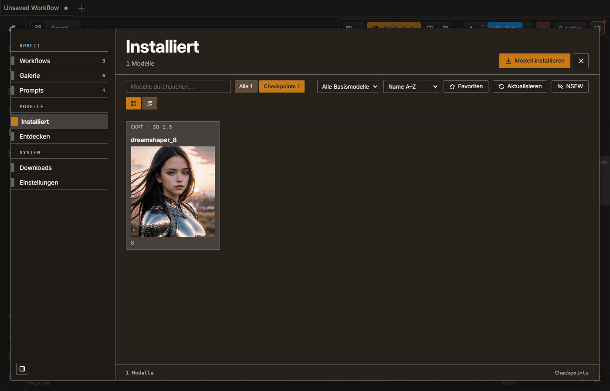
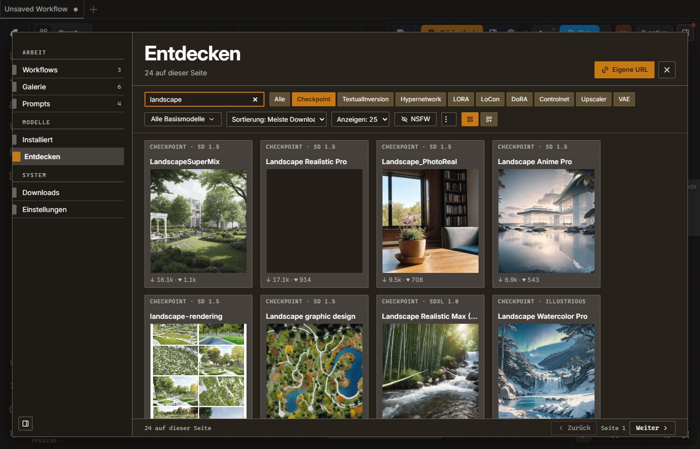
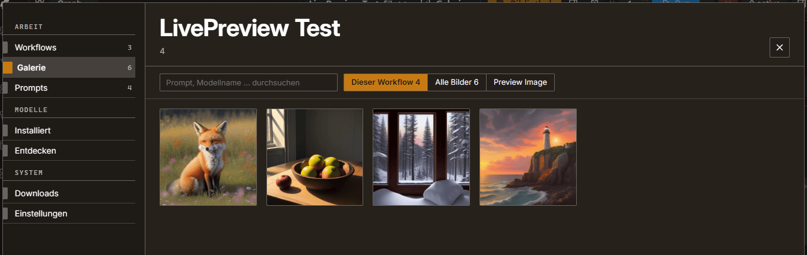
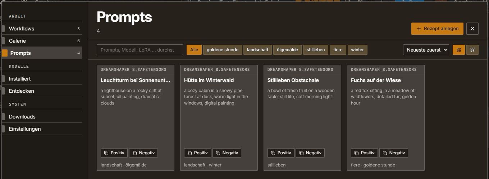
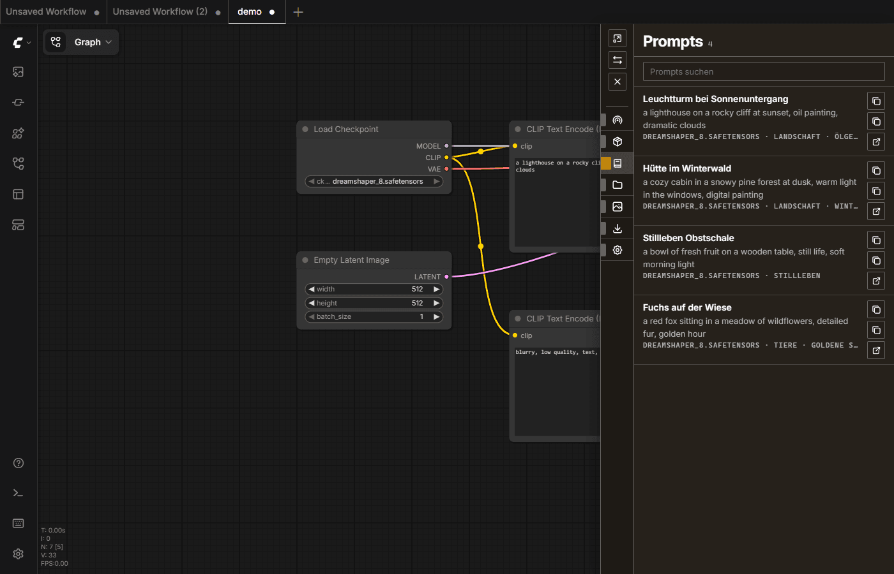
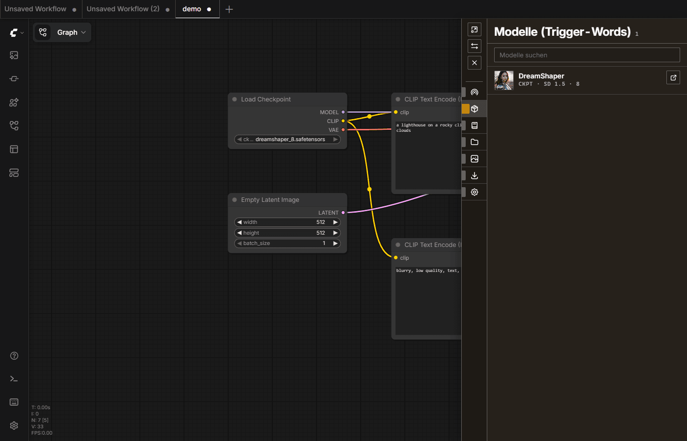
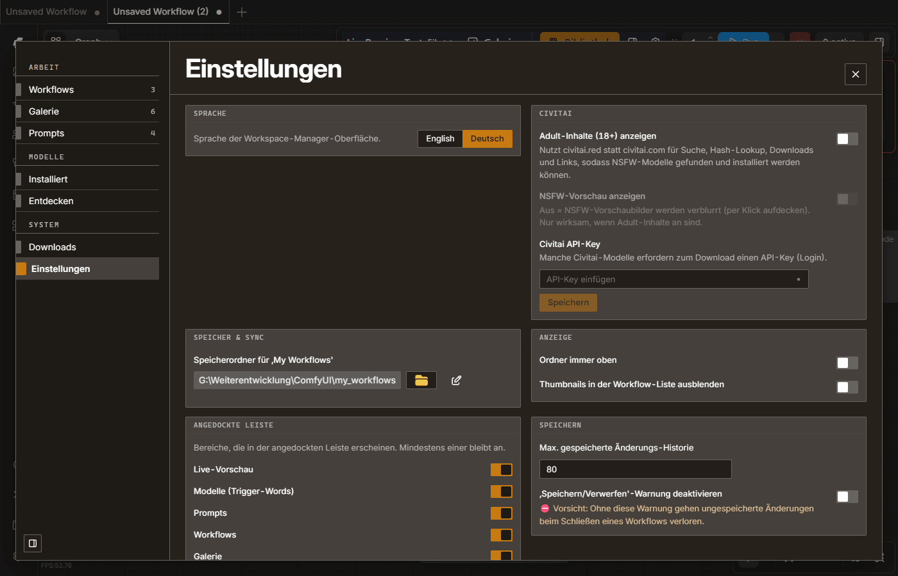

# ComfyUI Workspace Manager (Fork)

**English summary:** A ComfyUI extension that puts workflows, models, generated images and prompt recipes into one
library. It includes Civitai search with one-click model installation, a gallery with live preview and parameter view,
a prompt library, and a compact docked bar for working next to the node graph. The UI is available in German and
English (default: English, switch in the settings). This is a maintained fork of
[11cafe/comfyui-workspace-manager](https://github.com/11cafe/comfyui-workspace-manager) (MIT license).

**Install:**

```
cd ComfyUI/custom_nodes
git clone https://github.com/breiti35/comfyui-workspace-manager.git
```

Restart ComfyUI. Optionally pin a release with `git checkout v2.1.0` inside the cloned folder. The built frontend
(`dist/`) is part of the repository, so no Node.js is needed to use it. Environment variables for servers and
containers (RunPod and similar) are listed under [Einstellungen und Umgebungsvariablen](#einstellungen-und-umgebungsvariablen).

---

## Was ist das?

Der Workspace Manager ist eine Erweiterung für ComfyUI. Er bringt Workflows, Modelle, Bilder und Prompt-Rezepte in
einer Bibliothek zusammen: suchen, ordnen, wiederfinden, ohne den Knoteneditor zu verlassen. Zum Stöbern öffnet sich
ein großes Bibliotheksfenster; zum Arbeiten kann die Bibliothek als schmale Leiste an den Rand angedockt werden, der
Graph bleibt dabei bedienbar.

Dieses Repository ist ein Fork von [11cafe/comfyui-workspace-manager](https://github.com/11cafe/comfyui-workspace-manager).
Das Original wird seit April 2025 nicht mehr gepflegt; der Fork wird weiterentwickelt (aktuelles Release: `v2.1.0`).
Vielen Dank an 11cafe und die Mitwirkenden des Originals für die Grundlage. Das Projekt steht weiter unter der
MIT-Lizenz (siehe [LICENSE](LICENSE), Copyright 2024 11cafe).

Neu gegenüber dem Original: Civitai-Suche mit Basismodell-Filter und Ein-Klick-Installation, robuste Downloads,
Galerie mit Live-Vorschau und Parameter-Ansicht, Prompt-Bibliothek, angedockte Kompaktleiste, überarbeitete
Oberfläche (Karteistil, zweisprachig) sowie Schutzmaßnahmen für öffentlich erreichbare Server.

## Bedienung im Überblick

In der ComfyUI-Aktionsleiste oben rechts sitzt der Knopf **Bibliothek**. Er öffnet das Bibliotheksfenster (zuletzt
genutzter Bereich). Daneben:

| Element | Wirkung |
|---|---|
| Download-Anzeige | Zeigt laufende Downloads app-weit, auch bei geschlossenem Fenster. |
| Seitlich andocken | Wechselt zwischen Fenster und angedockter Leiste; der Zustand bleibt erhalten. |
| Einstellungen | Öffnet den Bereich Einstellungen der Bibliothek. |

Esc oder der Zurück-Knopf führt immer genau eine Ebene zurück; Suche, Filter und Scrollposition bleiben erhalten.
Das Fenster hat eine feste Seitenleiste mit diesen Bereichen:

- Arbeit: Workflows, Galerie, Prompts
- Modelle: Installiert, Entdecken
- System: Downloads, Einstellungen

## Funktionen

### Modelle: Installiert



- Zeigt die lokal installierten Modelle (Checkpoints, LoRAs, VAEs u. a.) als Karten mit Vorschaubild; Raster- und
  Kompaktansicht, Suche, Filter nach Modelltyp und Basismodell, Sortierung, Favoriten.
- Die Modelle werden per Hash bei Civitai wiedererkannt; Vorschau, Basismodell und Trigger-Words kommen von dort.
  Für gelöschte Civitai-Modelle gibt es einen Fallback über CivArchive.
- Detailansicht je Modell mit Trigger-Words zum Kopieren.
- NSFW-Vorschaubilder sind standardmäßig unscharf (per Klick aufdeckbar).

### Modelle: Entdecken (Civitai)



- Suche in Civitai, Reiter je Modelltyp (Checkpoint, LoRA, LoCon, DoRA, ControlNet, VAE u. a.), Sortierung,
  Seitengröße und Vor/Zurück.
- Der Basismodell-Filter wird live aus Civitai geladen (`/api/v1/enums`).
- Ein Klick installiert das Modell in den passenden Unterordner von `models/`. Der Download läuft in mehreren
  Segmenten parallel und zeigt Tempo und Restzeit; er lässt sich abbrechen.
- „Eigene URL“ lädt eine Datei von einer beliebigen Adresse; für geschützte Hugging-Face-Repos wird `HF_TOKEN` genutzt.
- Bereits installierte Modelle sind in der Liste markiert.

### Galerie



- Jedes erzeugte Bild und Video wird dem aktuellen Workflow zugeordnet. Ein Segmentschalter wechselt zwischen
  „Dieser Workflow“ und „Alle Bilder“.
- Suche über Prompt und Modellname; Bilder und Videos werden gefenstert geladen, auch große Bestände bleiben flüssig.
- Die Detailansicht zeigt die Erstellungsdaten (Prompts, Modell, Sampler, Schritte, CFG, Seed, Größe) und bietet
  „Als Rezept speichern“.

### Prompts (Rezepte)



- Ein Rezept speichert Positiv- und Negativ-Prompt samt Modell, LoRAs, Sampler und Seed, dazu Tags.
- Suche über Prompt, Modell und LoRA; Tag-Filter; Sortierung; Positiv und Negativ lassen sich direkt kopieren.
- Rezepte liegen serverseitig in `db/prompts.json` und überstehen daher das Löschen von Browserdaten.

### Workflows

- Workflows als Karten mit Vorschaubild (Titelbild oder jüngstes Medium) oder als dichte Liste; Ordner, Tags,
  Filter „Zuletzt“, Sortierung und Mehrfachauswahl.
- Schnellsuche mit `Strg+P`, Ordner-Drop-Leiste zum Einsortieren, Versionsverlauf je Workflow, Import und Export.
- Die Workflows liegen als Dateien im Speicherordner („My Workflows“, Standard `ComfyUI/my_workflows`) und werden in
  beide Richtungen mit der Oberfläche abgeglichen.

### Angedockte Leiste



Die Leiste am Rand lässt den Graphen bedienbar (links oder rechts andockbar). Bereiche: Live-Vorschau (jüngstes Ergebnis mit Parametern),
Modelle (mit Trigger-Words zum Kopieren), Prompts (Kopieren von Positiv und Negativ), Workflows, Galerie, Downloads
und Einstellungen. Welche Bereiche sichtbar sind, stellt man unter Einstellungen > „Angedockte Leiste“ ein.
„In Bibliothek öffnen“ führt vom Eintrag direkt zur Detailseite im Fenster.



### Downloads

Eigener Bereich im Fenster (und in der Leiste) für laufende und beendete Downloads mit Fortschritt, Tempo und
Abbrechen. Fehlgeschlagene Downloads zeigen einen Hinweis.

### Einstellungen



Sprache (Deutsch/Englisch), Civitai (Adult-Inhalte, NSFW-Vorschau, API-Key), Speicherordner für Workflows, Anzeige,
angedockte Leiste, Speichern (Änderungsverlauf, Warnung), Tastenkürzel (Standard: `Shift+S` speichern,
`Strg+Alt+S` speichern unter, `Strg+P` Schnellsuche).

## Installation

Voraussetzung: eine funktionierende ComfyUI-Installation und `git`.

```
cd ComfyUI/custom_nodes
git clone https://github.com/breiti35/comfyui-workspace-manager.git
```

ComfyUI neu starten und die Seite neu laden. Das gebaute Frontend (`dist/`) liegt im Repository, Node.js ist nur für
die Entwicklung nötig. Wer ein festes Release möchte:

```
cd comfyui-workspace-manager
git checkout v2.1.0
```

Update auf den neuesten Stand: `git checkout main && git pull` (bzw. `git pull` auf dem gewählten Zweig), danach
ComfyUI neu starten. Ein Wechsel vom Original (11cafe) geht ebenso: Ordner ersetzen oder `git remote set-url origin`
auf die Fork-Adresse. Workflows im Speicherordner bleiben dabei erhalten; Galerie-Verknüpfungen und Versionen liegen
im Browser (IndexedDB) und gehen beim Wechsel des Browsers nicht mit.

## Einstellungen und Umgebungsvariablen

Die meisten Einstellungen stehen im Bereich „Einstellungen“. Der Civitai-API-Key wird serverseitig gespeichert
(`db/settings.json`) und nur für Downloads benötigt, die Civitai hinter einen Login stellt.

Für Server und Container gibt es Umgebungsvariablen (alle optional):

| Variable | Wirkung |
|---|---|
| `WORKSPACE_MANAGER_MODEL_ROOT` | Bevorzugt für Downloads den Modellpfad unter diesem Wurzelverzeichnis (aus `extra_model_paths.yaml`), z. B. `/workspace`, damit Modelle auf dem Volume landen statt auf der Container-Platte. |
| `WORKSPACE_MANAGER_HASH_DIR` | Ordner für den Hash-Cache der Modelle, damit nach einem Neustart nicht neu gehasht wird. Standard: `hash/` im Erweiterungsordner. |
| `WORKSPACE_MANAGER_BROWSE_ROOTS` | Begrenzt Ordnerauswahl, Kopierziel und Workflow-Speicherordner auf die angegebenen Verzeichnisse (mehrere mit dem Pfadtrenner des Systems getrennt). Ohne Angabe gibt es keine Einschränkung. |
| `HF_TOKEN` | Hugging-Face-Token für Downloads aus geschützten Repositories. |

## Runpod und öffentliche Server

Der Fork wird auch in Runpod-Images genutzt. Dort sind in der Regel `WORKSPACE_MANAGER_MODEL_ROOT` und
`WORKSPACE_MANAGER_HASH_DIR` auf das Volume gesetzt (`/workspace`). `WORKSPACE_MANAGER_BROWSE_ROOTS` sollte nur
gesetzt werden, wenn die Ordnerauswahl eingeschränkt werden muss. Dateirouten sind gegen Pfade außerhalb der
erlaubten Ordner geschützt. ComfyUI selbst hat keine Anmeldung: Wer die Adresse des Pods kennt, erreicht auch die
Routen des Managers, darunter den gespeicherten Civitai-Key. Den Pod entsprechend absichern.

## Entwicklung

Hinweise für Entwickler stehen in [README_for_developer.md](README_for_developer.md). Kurzfassung:

```
cd ui
npm install
npm run build          # baut das Frontend nach dist/
pwsh scripts/run_tests.ps1   # im Projektordner: Backend (pytest) und Frontend-Tests
```

Änderungen am Frontend gehören nach `ui/src`; `dist/` entsteht per Build und wird getrennt committet. Alle
Oberflächentexte laufen über `ui/src/i18n/` (Deutsch und Englisch). Hintergrund und Entwurfsentscheidungen:
[PRODUCT.md](PRODUCT.md), [DESIGN.md](DESIGN.md) und `docs/`.

## Danksagung und Lizenz

- Original: [11cafe/comfyui-workspace-manager](https://github.com/11cafe/comfyui-workspace-manager), MIT-Lizenz.
- ComfyUI: [comfyanonymous/ComfyUI](https://github.com/comfyanonymous/ComfyUI).
- Anzeige von Medien angelehnt an [talesofai/comfyui-browser](https://github.com/talesofai/comfyui-browser).

Lizenz: MIT, siehe [LICENSE](LICENSE).
